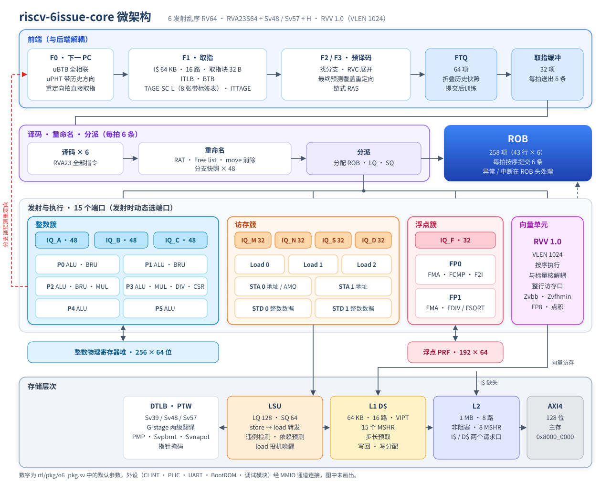
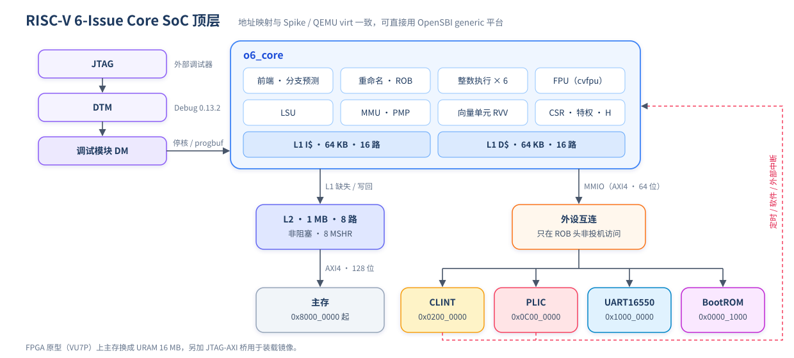
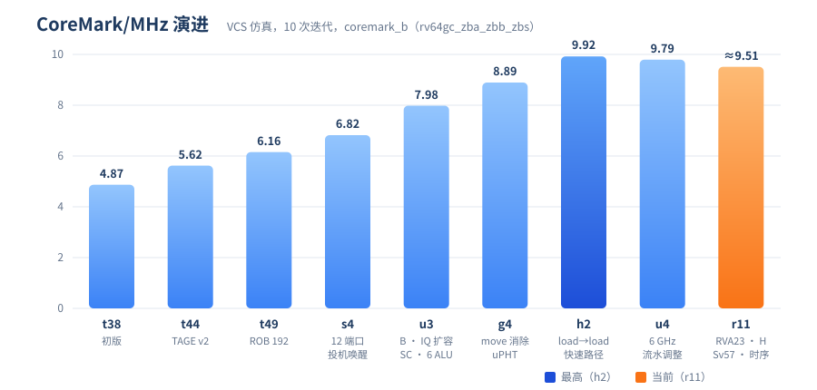

# riscv-6issue-core

riscv-6issue-core 是一个 **6 发射乱序 RV64 应用处理器核**，参照 **RVA23S64** 配置实现，另外支持 **Sv48 / Sv57** 和 **H 扩展**（两级地址翻译），带 **RVV 1.0 向量单元**（VLEN = 1024）。

- 所有功能都与 Spike 逐条提交对拍验证。
- Linux 6.18 能在 Sv57 下启动到用户态。
- ASIC 实现目标是 2nm 虚拟工艺（2nm virtual pdk）下 6 GHz，块级时序收敛还在进行中。
- FPGA 原型平台是 Xilinx VU7P。

> "6 发射"指取指之后的 **译码 / 重命名 / 分派 / 提交 每拍 6 条**；执行端有 15 个发射端口。

---

## 目录

- [主要特性](#主要特性)
- [微架构](#微架构)
- [仿真结果](#仿真结果)
- [目录结构](#目录结构)
- [快速开始](#快速开始)
- [许可证](#许可证)

---

## 主要特性

| 类别 | 内容 |
|---|---|
| ISA | RV64 IMAFDC + B (Zba/Zbb/Zbs) + V + H，Zicsr / Zifencei / Zicntr / Zihpm |
| RVA23 扩展 | Zicond、Zcb、Zfa、Zawrs、Zimop / Zcmop、Zicbom / Zicboz / Zicbop、Zvbb、Zfhmin / Zvfhmin、Sstc、Sscofpmf、Svinval、Svnapot、Svpbmt、Smstateen / Ssstateen、Ssnpm / Smnpm（指针掩码）等 |
| 特权 | M / HS / U + VS / VU；Sv39 / **Sv48 / Sv57**；G-stage Sv39x4 / Sv48x4 / Sv57x4；PMP 8 项 |
| 宽度 | 6 宽译码 / 重命名 / 分派 / 提交，15 个执行端口 |
| 乱序窗口 | ROB 258 项（43 行 × 6），在途分支 48 个 |
| 物理寄存器 | 整数 256 × 64 位，浮点 192 × 64 位 |
| 访存 | LQ 128、SQ 64；3 条 load 流水 + 2 条 STA + 2 个 STD 口；load 投机唤醒；load → load 快速路径 |
| 缓存 | L1I 64 KB 16 路，L1D 64 KB 16 路（15 个 MSHR + 步长预取），L2 1 MB 8 路（非阻塞） |
| 分支预测 | uBTB + uPHT（带历史）、BTB、TAGE-SC-L（8 张带标签表）、ITTAGE、链式 RAS，FTQ 64 项 |
| 浮点 | cvfpu（FPnew）：FP64 / FP32（NaN-boxing），FMA 4 级流水；Zfa、Zfhmin |
| 向量 | RVV 1.0 按序向量单元，与标量乱序核解耦，VLEN = 1024，含 FP8 与点积扩展 |
| 系统 | CLINT、PLIC、UART16550、BootROM，RISC-V Debug 0.13.2（JTAG），每个 SRAM 一个 MBIST 引擎 |

---

## 微架构

### 总体框图

<p align="center"></p>

### SoC 顶层

<p align="center"></p>

地址映射与 Spike / QEMU virt 一致，可以直接用 OpenSBI generic 平台加设备树。

### 关键机制

- **分支恢复：** 每个条件分支 / JALR 分配一个分支标签并保存 RAT 快照，每个 uop 带依赖掩码。误预测时一拍作废后续指令，RAT、free list、LQ / SQ、ROB 尾指针一起恢复。异常、中断和访存违例只在 ROB 头处理。
- **load 投机唤醒：** load 在判定命中之前就唤醒消费者，判定失败时逐级毒化并取消。对齐的 64 位 load 之间另有一条 load → load 快速路径，指针追逐时少一拍。
- **move 消除：** `mv` / `c.mv` / `li rd,0` 在重命名时直接改映射，不占执行端口。提交侧给物理寄存器计引用数，计数归零才释放。
- **前端：** uPHT 用全局历史给 uBTB 提供方向，减少 F3 覆盖重定向。FTQ 保存折叠历史快照，误预测时一拍恢复。分支误预测后的重定向拍可以直接取指（F0 旁路）。
- **两级翻译（H 扩展）：** PTW 状态机加了 G 阶段。TLB 存两级合并后的项，按页级取两级中较小的一级。guest page fault 时 GPA 经 ROB 送到 `htval` / `mtval2`。

---

## 仿真结果

所有测试都与 Spike 逐条提交对拍，比对 PC、指令、写回值、CSR 副作用和陷入原因。仿真器为 Synopsys VCS；Linux 启动用 Verilator。

### 回归测试（r11，2026-11-06）

| 测试集 | 结果 |
|---|---|
| riscv-tests ISA（rv64ui/um/ua/uc/uf/ud/mi/si/uzba/uzbb/uzbs，-p / -v） | **322 / 322** |
| 定向测试 | **18 / 18** |
| 随机：整数 / 浮点 / RVA23 / CSR / 虚拟内存 / H / H 两级翻译 | 各 **10 / 10** |
| 基准程序（13 个，全部带对拍） | 全部通过 |
| `unique` / `priority` 违例 | 0 |

> `rv64ui-p-ma_data` / `rv64ui-v-ma_data` 预期不过：未对齐访存按规范走陷入，由 OpenSBI 模拟。

更早的 r6 回归里，七类随机测试各跑了 30 / 30。

### 合规测试（ACT4，riscv-arch-test）

| 扩展组 | 结果 |
|---|---|
| Zicond / Zcb / Zcmop / Zimop 等（R1） | 62 / 62 |
| Zicbom / Zicboz / Zicbop | 7 / 7 |
| Zfa + F / D | 226 / 226 |
| 特权：Sv / Svnapot / Svpbmt / Svinval / SvPMP 等 | 256 / 269 |

特权组的 13 项差异都已定位：9 项是测试配置漏声明了 Smstateen；4 项是 Sail 参考模型对 store access fault 的 `mtval` 报物理地址，DUT 和 Spike 都按规范报虚地址。

### 系统级：Linux 启动（Sv57）

| 项 | 结果 |
|---|---|
| 软件 | OpenSBI + Linux 6.18 + BusyBox |
| 对拍 ISA | RV64IMAFDCVH + 全部 RVA23 扩展 |
| 结果 | **PASS**：`/proc/cpuinfo` 显示 `mmu: sv57`，跑到 `/init`，正常关机 |
| 规模 | 50,898,123 拍，67,047,626 条提交，IPC 1.317，全程对拍无差异 |

### 基准程序 IPC（r10 → r11）

测量区 IPC = minstret / mcycle；拍数是整个程序的周期数，越少越好。r11 加入了 6 GHz 时序修改（PTW 请求打拍、D$ 预取口打拍）。

| 基准 | IPC（r11） | 拍数 r10 | 拍数 r11 | 变化 |
|---|---:|---:|---:|---:|
| dhrystone | 4.032 | 58,631 | 58,631 | 0.0% |
| multiply | 5.177 | 13,648 | 13,664 | +0.1% |
| vvadd | 4.027 | 4,410 | 4,427 | +0.4% |
| rsort | 3.215 | 115,794 | 115,856 | +0.1% |
| interp | 3.038 | 294,422 | 294,422 | 0.0% |
| spmv | 2.668 | 32,918 | 34,008 | +3.3% |
| towers | 1.450 | 7,902 | 7,937 | +0.4% |
| memcpy | 0.924 | 12,847 | 12,825 | −0.2% |
| median | 0.828 | 15,676 | 15,974 | +1.9% |
| qsort | 0.653 | 223,626 | 223,392 | −0.1% |
| mm | — | 124,778 | 124,808 | 0.0% |
| coremark_b（rv64gc_zba_zbb_zbs） | — | 1,069,369 | 1,069,992 | +0.06% |

spmv 和 median 变慢主要来自预取口打拍。去掉这一拍的对照版本能逐拍复现 r10 的结果；两者的分支误预测率也随之变化，因此推断是分支预测器受到了扰动。

### CoreMark/MHz 演进

CoreMark 在仿真里跑 10 次迭代（达不到官方要求的 10 秒），分数只作 CoreMark/MHz 估算。

| 版本 | 主要改动 | CoreMark/MHz |
|---|---|---:|
| t44 | TAGE v2 + 跨块训练修正 | 5.622 |
| t49 | ROB 192、L1 32 KB | 6.155 |
| s4 | 执行端口 8 → 12，load 投机唤醒 | 6.821 |
| u3 | B 扩展、IQ 扩容、SC + ITTAGE、6 个 ALU | 7.981 |
| g4 | load-to-use 缩短、move 消除、uPHT、F0 重定向旁路 | 8.894 |
| **h2** | load → load 快速路径、IQ_M 64 / IQ_C 48 | **9.922** |
| u4 | 6 GHz 流水调整（重命名加一拍等）后 | 9.792 |
| r11 | RVA23 + Sv57 + H 扩展 + 6 GHz 时序修改后 | ≈ 9.51 |

<p align="center"></p>

h2 之后的小幅下降来自为 6 GHz 时序加的流水级。

### 分支预测器对比（trace 模型）

方法：用 Spike 生成真实程序的分支 trace，在同一批 trace 上跑三组配置。"香山参考"是按公开设计文档参数**近似**的模型，不是 RTL 精确模型；拿不准的参数一律取对香山有利的值。

CoreMark（327 万条指令）：

| 预设 | 条件 MPKI | 气泡 / 千条 | 损失周期 / 千条 | 前端 IPC 上限 |
|---|---:|---:|---:|---:|
| 改进前（cur） | 2.34 | 44.4 | 77.3 | 3.80 |
| 香山参考（xs） | 1.17 | 15.8 | 32.2 | 5.00 |
| riscv-6issue-core v2（入口起 32 B，每块 ≤ 2 分支） | **1.04** | **15.3** | **30.0** | 4.65 |

Linux 负载（OpenSBI + Linux 启动 + BusyBox，17.5 亿条指令）：

| 预设 | 总 MPKI | 气泡 / 千条 | 损失周期 / 千条 | 前端 IPC |
|---|---:|---:|---:|---:|
| 改进前 | 1.43 | 162.5 | 182.6 | 2.61 |
| 香山参考 | 1.24 | 42 | 60 | 4.34 |
| **riscv-6issue-core v2 全部改进** | **1.06** | 47 | 61 | **4.52** |

在这些负载上，v2 的误预测比香山参考少约 15%，前端吞吐高约 4%，分支损失周期基本持平。

---

## 目录结构

```
rtl/            核与 SoC 的 RTL（SystemVerilog）
  pkg/          全局参数 o6_pkg.sv（所有尺寸参数都在这里）
  frontend/     取指、uBTB/BTB、TAGE-SC-L、ITTAGE、RAS、FTQ
  backend/      译码、重命名、分派、发射队列、ROB
  exu/ fpu/     整数执行单元、乘除法、浮点（封装 cvfpu）
  lsu/ cache/   LSU、I$、D$、L2
  mmu/ csr/     TLB、PTW、PMP、CSR（含 H 扩展）
  vec/          RVV 1.0 向量单元
  soc/ debug/   SoC 顶层、外设、调试模块
  common/ asic/ 通用单元、SRAM 封装、时钟门控
third_party/    cvfpu（FPnew），带本地补丁，见 O6_PATCHES.md
fpga/           VU7P 原型：顶层、JTAG-AXI 桥、URAM 主存、Vivado 脚本
sw/             BootROM、调试程序、Linux 镜像配置与设备树
tb/             测试平台：tb_top（Spike 对拍）、单元 TB、UVM、门级、FPGA 桥
verif/          测试程序：随机指令生成器、定向测试、基准、ACT4 配置、形式证明、分支预测模型
scripts/        编译测试程序、VCS / Verilator 仿真、回归与覆盖率脚本
```

---

## 快速开始

需要：Synopsys VCS（或 Verilator）、`riscv64-unknown-elf-gcc`、Spike（`riscv-isa-sim`，用来编对拍库）。

编译对拍库和测试程序：
```bash
scripts/build_cosim.sh
```
```bash
scripts/build_tests.sh
```
编译仿真模型：
```bash
scripts/run_vcs.sh build
```
跑一组 ISA 测试：
```bash
scripts/run_isa.sh 'rv64ui-p-*'
```
跑随机程序（起始种子、个数）：
```bash
scripts/run_rand.sh 100 10
```
完整回归（ISA + 定向 + 七类随机 + 基准），结果汇总到 `work/regress_<标签>.txt`：
```bash
NRAND=10 JOBS=8 bash scripts/regress.sh mytag
```
FPGA 比特流（需先按板卡填写 `fpga/board/board.xdc`）：
```bash
vivado -mode batch -source fpga/vu7p/build.tcl -tclargs fpga/board/board.xdc
```

FPGA 原型最近一次实测是 75 MHz，布线后 WNS +0.075 ns，用的是 2026-10-10 的 RTL，当前 RTL 还没重新实现。

---

## 许可证

本仓库代码按 [MIT License](LICENSE) 发布。`third_party/cvfpu` 保留其原许可证（Apache 2.0 / Solderpad），见该目录下的许可证文件。
